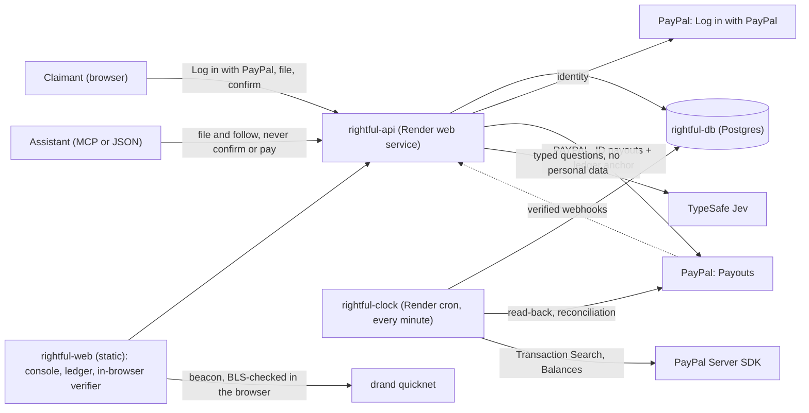
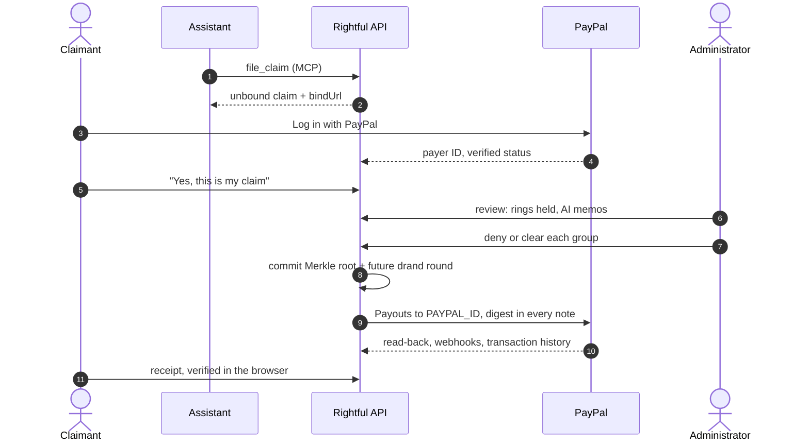

<p align="center">
  <picture>
    <source media="(prefers-color-scheme: dark)" srcset="docs/assets/logo-dark.svg">
    
  </picture>
</p>

<p align="center">
  <strong>Settlement payouts claim farms can't drain.</strong><br>
  One claim per verified PayPal account, AI-triaged rings a person decides,<br>
  and a payout ledger PayPal itself keeps a copy of.
</p>

<p align="center">
  <a href="https://rightful-web.onrender.com">Live app</a> ·
  <a href="#for-judges">For judges</a> ·
  <a href="#architecture">Architecture</a> ·
  <a href="#run-it-locally-windows-macos-linux">Run locally</a> ·
  <a href="LICENSE">MIT licence</a>
</p>

> PayPal **sandbox only**. No real money and no real personal data anywhere.

## For judges

| What | Link | Sign-in |
| --- | --- | --- |
| **Live app** | https://rightful-web.onrender.com | None |
| **Start here: a guided tour** of the whole app, step by step (about four minutes) | https://rightful-web.onrender.com/tour | None |
| **Run a whole $2M settlement** as its administrator: triage 105 groups with AI memos, commit, pay, verify (~10 s to seed) | https://rightful-web.onrender.com → **Run a $2M program as the administrator** | None |
| **A real sandbox payout**, as its claimant sees it | https://rightful-web.onrender.com/claim/clm_n1bJwZ5ALKjI0c_K | None |
| **Its receipt and the ledger**, checked in your browser (Merkle root, PayPal's records, drand BLS, audit sample); PayPal's transaction history agrees with it | https://rightful-web.onrender.com/l/prg_7Gj9VD1w1pfaBqZ_?claim=clm_n1bJwZ5ALKjI0c_K → **Verify in my browser** | None |
| **File a claim yourself** (open until Dec 19); sign in again to see a second claim refused | https://rightful-api.onrender.com/claim/start?program=prg_rh4Pg_Ch_CzamLn9 | US sandbox *personal* account |
| **Let an assistant file for you** (MCP, Streamable HTTP) | `https://rightful-api.onrender.com/mcp` · [docs/agents.md](docs/agents.md) | None |
| **API contract** (OpenAPI 3.1) | https://rightful-api.onrender.com/openapi.json | None |
| **Health** | https://rightful-api.onrender.com/health | None |
| **Code map** for reviewers and agents | [AGENTS.md](AGENTS.md) · [docs/architecture.md](docs/architecture.md) | |

### Highlights

- **PayPal end to end.** Log in with PayPal, Payouts, Payouts read-back, Transaction Search,
  Balances and verified webhooks form one money path ([table](#paypal-surfaces)). The ledger is
  committed in the same transaction that fixes the share, batch IDs make retries harmless
  ([`distribute.ts`](src/claims/distribute.ts)), and the ledger's digest is written into PayPal's own
  payout records and read back.
- **AI that cannot invent facts or decide.** The investigator answers typed questions, every fact in
  a memo is computed in code, the model never sees personal data or PayPal IDs, and a person makes
  every call ([AI in Rightful](#ai-in-rightful)).
- **Agents file; people get paid.** An assistant can file and follow claims over MCP but has no way
  to confirm one, decide one or be the payee; the person confirms by signing in with PayPal. The
  JSON API has an OpenAPI 3.1 contract generated from the same schemas.
- **Proof anyone can check.** Each claimant's receipt leads to a Merkle root committed before money
  moved, PayPal's records of the payment carry the same digest, drand's public randomness picks the
  audit, and PayPal's transaction history is checked against the ledger.
- **What it changes.** On the $2M demo, each real claimant's share goes from $400 to $631.91 and
  money reaching rings from $600,000 to $48,025; a held claimant can ask a person to look again.
  The fraud it targets is documented in real settlements ([the problem](#the-problem)).
- **See the attack unfold.** A Bryntum Scheduler timeline puts every held group on one time axis,
  sorted by the investigator's fraud probability, with each claim at the moment it was filed and a
  replay of the filings; farms show as bursts, households as a few claims over weeks.
- **Ready to run and review.** No sign-in needed for the full demo; mobile-first, accessible
  claimant pages; one Render Blueprint; 70 tests with evaluation gates in CI; setup that works on
  Windows, macOS and Linux.

## The problem

A settlement or mass refund splits a fixed pool over every valid claim, so **every fake claim is
taken from a real person**. Claim fraud has become industrial:

- A payment processor's report counted more than **80 million claims in 2023 with "significant"
  signs of fraud, up over 19,000% since 2021**. A Chicco booster-seat settlement drew more than
  3.3 million claims for about 875,000 seats sold, and was put on hold; a Grande Cosmetics
  settlement drew 6.5 million claims, of which about 110,000 were valid; in the Juul/Altria
  settlement, administrators told the court about 80% of 14 million claims were likely fraudulent.
  Experts say the fraud is moving from bots to groups of people using stolen identities and
  addresses. ([Reuters, May 2024](https://www.insurancejournal.com/news/national/2024/05/03/772747.htm))
- In one case, nearly 5,500 claims came from a single IP address and nearly 1,000 from one
  single-family home: exactly the signals Rightful groups on.
  ([Foley & Lardner, July 2024](https://www.foley.com/insights/publications/2024/07/fraud-rising-claims-made-class-action-settlements/),
  citing *Opperman v. Kong Techs.*, N.D. Cal.)
- A claims administrator: "fraud is no longer just inevitable—it's industrialized."
  ([JND Legal Administration, Dec 2025](https://www.jndla.com/blog/administration-at-scale-the-emerging-role-of-ai-in-modern-claims-management))

Administrators are left paying the fraud or freezing everyone while they investigate, and real
claimants wait. Settlements already pay people through PayPal and Venmo: the $700M Google Play
settlement pays most people automatically that way
([Entrepreneur, Dec 2025](https://www.entrepreneur.com/business-news/heres-how-to-claim-your-part-of-a-700m-google-settlement/500752)).
PayPal is already where the money goes; Rightful makes it where the identity check and the proof
come from too.

**Who it is for:** claims administrators, and merchants running refund or recall programs. They plug
Rightful in for claim intake, ring triage and payout; claimants file free and are paid to their own
PayPal account. **How it would be sold:** per program, priced per paid claim.

## How it works

1. **One claim per verified PayPal account.** Claimants sign in with **Log in with PayPal**. The
   program sees a per-program pseudonym, never the PayPal account ID (kept only encrypted, to pay), and
   a second claim from the same account is refused; signing in again shows the existing claim.
2. **Agents can file; only people get paid.** A person's assistant can file over MCP or plain JSON
   (one path, one rate limit). It has no tool to confirm, decide or pay: the claim waits, unbound,
   until its person signs in with PayPal and confirms it.
3. **Rings are held, not paid.** Claims that share devices, inboxes, buildings, networks or a scripted
   story are grouped by a deterministic detector. An AI investigator rates each group, the memo's
   facts are computed in code, a fixed rule recommends deny, review or clear, and **a person decides**.
4. **Held is not denied.** Every claimant has a status page with no personal data on it. A claimant
   held for review can ask a person to look again, once; the request appears next to the memo in the
   console and decides nothing by itself.
5. **The ledger comes first.** Before any payout is sent, every payout (claim, pseudonym, amount) is
   hashed into a Merkle root that also names a drand round still in the future. Each claimant gets a
   receipt proving their payout is in it. The ledger is tamper-evident: once anyone has kept the root
   or a receipt, adding or changing a payout breaks the match.
6. **PayPal keeps a copy.** Every Payouts batch carries the ledger's digest in its message and every
   payment in its note, so each claimant's own PayPal payment names the ledger it was paid from.
7. **Paid to the account that signed in.** PayPal Payouts sends each share with
   `recipient_type: PAYPAL_ID` to the payer ID captured at sign-in, and nowhere else. A payout PayPal
   cannot deliver is listed in the ledger with PayPal's status; its money returns to the program and
   is never re-sent elsewhere.
8. **PayPal's books must agree.** A Balances check refuses to start a live program the account cannot
   fund. After payouts settle, every paid claim is looked up in PayPal's transaction history: a
   completed debit of exactly the share, under the transaction ID Payouts gave it, with a note naming
   the ledger. Signature-verified webhooks make the API read a batch back sooner.
9. **An audit nobody picks.** Once the committed drand round is out, its randomness picks the claims to
   audit. Anyone can recompute the ledger and the sample in their browser.

### PayPal surfaces

| Surface | Role in Rightful | Code |
| --- | --- | --- |
| Log in with PayPal | Verified-account gate; the payer ID behind the one-claim rule and the payout | [`identity.ts`](src/paypal/identity.ts), [`login.ts`](src/api/login.ts) |
| Payouts (`PAYPAL_ID`) | Pays each approved claim to the account that signed in; the ledger digest rides in the batch message and every item note | [`payouts.ts`](src/paypal/payouts.ts), [`payouts-port.ts`](src/claims/payouts-port.ts) |
| Payouts read-back | Source of truth for delivered or not; reads the ledger anchor back from PayPal | [`distribute.ts`](src/claims/distribute.ts) |
| Transaction Search (PayPal Server SDK) | Every paid claim found in PayPal's own history, exactly as the ledger says | [`sdk.ts`](src/paypal/sdk.ts), [`reconcile.ts`](src/claims/reconcile.ts) |
| Balances (PayPal Server SDK) | A live program refuses to pay if the account cannot fund it | [`sdk.ts`](src/paypal/sdk.ts), [`reconcile.ts`](src/claims/reconcile.ts) |
| Webhooks + signature verification | Payouts events verified with PayPal, recorded once by event ID, then a read-back | [`webhooks.ts`](src/claims/webhooks.ts) |

Every money call carries a `PayPal-Request-Id` derived from our own IDs, batch IDs come from the
program (a retry returns the original batch), and the client refuses anything but the sandbox
([`client.ts`](src/paypal/client.ts)).

### AI in Rightful

The AI's job is triage: explaining suspicious groups so a person can decide quickly and fairly.

- **Typed questions, not free text.** For each group, TypeSafe Jev answers three questions: how
  likely it is a coordinated operation (a probability), which known pattern fits (a choice from a
  fixed list), and how strong the evidence is (0-4). Out-of-range or off-list answers are refused and
  the group goes to a person ([`investigate.ts`](src/rings/investigate.ts)).
- **Facts come from code.** Every fact in a memo ("14 claims came from 2 devices") is computed from
  the claims, never written by the model. A fixed rule turns the answers into deny, review or clear.
- **No personal data reaches the model.** It sees a case file with stand-in labels ("device D1",
  "inbox M2"): no emails, addresses, IPs or PayPal identifiers.
- **It never decides and never touches money.** A person denies or clears every group; amounts and
  payees are computed in code and paid by PayPal.
- **Measured, recorded, replayable.** Answers are recorded once and replayed, so the hosted demo,
  judges and CI need no key, and CI fails if the held-out numbers slip.

### Architecture



The money path, from claim to proof:



Service by service, and why each is separate: [docs/architecture.md](docs/architecture.md).

## Numbers, and what they measure

On the demo program (a held-out seed the investigator was never tuned on), the investigator
recommends denying 50 groups (1,255 ring claims, no real claimant) and clearing 25 (96 real
claimants, no ring claim), and leaves 30 mixed groups (155 ring claims, 77 real claimants) to a
person:

| How the $2M is paid | Each paid claim | To rings | Real claimants denied |
| --- | --- | --- | --- |
| Pay every claim | $400.00 | $600,000 | 0 |
| Pay every verified PayPal account | $460.08 | $551,176 | 351 (unverified accounts) |
| Rightful, mixed groups all cleared | $588.75 | $136,001 | 0 |
| Rightful, mixed groups all denied | $631.91 | $48,025 | 77 |

A person who opens the mixed groups lands between the last two rows. In every Rightful row, 334 real
claimants with unverified PayPal accounts are held (not denied) until they verify. **So in the
strictest row, 411 of 3,500 real claimants (11.7%) are not paid at distribution: 77 denied and 334
waiting to verify.** Those 77 can ask for a review before anyone decides.

- **Detector, held-out programs** (seeds 101-110, 5,000 claims each, 30% from rings): 99.9%
  precision, 93.5% recall, 0.1% of genuine claimants held. Paying every verified account instead:
  45.9% precision, 20.0% recall, about $552k of a $2M pool to rings. Rings built to evade (distinct
  everything, own words, filed over weeks) are not caught; one claim per PayPal account is the
  backstop.
- **Investigator, held-out** (seeds 101-105, a sensitive detector setting that also flags
  households): its deny recommendations are right 98.7% of the time, it cleared no ring, and it
  cleared 62% of the innocent groups, cutting genuine claimants held from 4.6% to 1.8%.

**All of these numbers come from our own synthetic generator** ([`synthetic.ts`](src/rings/synthetic.ts)),
with known rings of four kinds and genuine claimants built to look suspicious (households, dorms,
people who paste the sample text). They measure the system against that generator, not against real
fraud.

## What is real and what is simulated

- **Real, in the PayPal sandbox:** Log in with PayPal, Payouts to `PAYPAL_ID` (the live checks pay
  $1.00 per claim), PayPal's read-back of the ledger anchor, Transaction Search, Balances, webhooks.
- **Simulated:** the $2M demo's 5,000 claimants are synthetic, so its Payouts batches are simulated
  (no sandbox account holds $2M, and synthetic people have no PayPal accounts). Its ledger, drand
  round, audit sample and verifier are real; the verifier marks the PayPal check "not applicable".
- **Replayed:** the hosted investigator replays recorded TypeSafe answers ([`eval/`](eval/)); with a
  key set it asks live for groups it has no answer for.
- **Sandbox lag:** PayPal's sandbox transaction history can trail payouts by hours; the ledger page
  shows "waiting for PayPal's history" until it catches up, and only reports a mismatch after that.

## Security and privacy

- Payer IDs are sealed with AES-256-GCM at rest; everything public uses a per-program HMAC pseudonym,
  so two programs cannot link the same person. Only the /24 of an IP address is kept.
- The public ledger and receipts carry no payer IDs, emails or addresses; the claim page shows none.
- Admin routes need a bearer token; demo programs get a console token that works on that demo only
  and is refused on live programs.
- Webhooks are verified with PayPal before anything is stored; agents' filings are rate limited per
  network and program; demo creation is rate limited per visitor.
- Secrets live in a Render env group generated at first deploy; the PayPal client cannot leave the
  sandbox.

## Project structure

```
rightful/
├── src/
│   ├── api/        Hono app and server: claimant pages, JSON API, Log in with PayPal, MCP server,
│   │               OpenAPI contract (app.ts, main.ts, claims.ts, login.ts, mcp.ts, contract.ts, pages.ts)
│   ├── claims/     Programs and claims, review, the ledger, distribution, reconciliation, webhooks,
│   │               the console's read (service.ts, ledger.ts, distribute.ts, reconcile.ts, webhooks.ts)
│   ├── paypal/     Sandbox-only REST client, Payouts, Log in with PayPal, the PayPal Server SDK
│   ├── rings/      Signals, the deterministic detector, the AI investigator, the synthetic generator
│   ├── engine/     Merkle trees, drand quicknet, per-program pseudonyms
│   ├── demo/       The hosted $2M demo: seeding, simulated Payouts, pruning
│   ├── db/         One interface over Postgres and PGlite; the schema
│   └── dev/        In-memory Payouts for local development and tests
├── web/            React + Vite app: home, guided tour, console (Bryntum timeline, AG Grid table), claim page, ledger, verifier
├── test/           node:test suites (70 tests), including evaluation gates and contract checks
├── scripts/        Open and pay programs, register the webhook, evals, demo, cron tick, migrations
├── eval/           Recorded investigator answers (replayed by the demo and CI)
├── docs/           Architecture, agents (MCP), sandbox setup, logo
├── render.yaml     Render Blueprint: every service, the database and secrets
├── paypal-plan.md  Contract sheet for the PayPal Server SDK integration
└── AGENTS.md       File-by-file map and the rules the code keeps
```

## Run it locally (Windows, macOS, Linux)

You need **Node.js 22 or newer** and **git**. The commands below are the same in PowerShell, Command
Prompt, Terminal and any Linux shell. No database to install (without `DATABASE_URL` the API runs
Postgres in-process with PGlite) and no PayPal app needed for the local demo.

```bash
git clone https://github.com/TusharTechs/rightful.git
cd rightful
npm install
```

**The whole app, with PayPal faked** (two terminals):

```bash
npm run dev:api:fake        # terminal 1: API on http://localhost:8787 (in-memory Payouts)
```

```bash
npm run dev:web             # terminal 2: web app on http://localhost:5173
```

Open http://localhost:5173 and click **Run a $2M program as the administrator**.

**Checks and evaluations:**

```bash
npm test                    # 70 tests: ledger, claims, payouts, webhooks, contract, detector, investigator
npm run typecheck
npm run demo                # seed the demo program in-process and print its rings and scoreboard
npm run eval:rings          # detector vs a VERIFIED-only baseline on synthetic programs (offline)
npm run eval:investigator   # the investigator's triage, replayed from eval/investigator.jsonl
```

**Against the PayPal sandbox:** copy `.env.example` to `.env` (`cp` on macOS/Linux, `copy` in
Command Prompt, `Copy-Item` in PowerShell), fill in your sandbox app's client ID and secret
([docs/day0-sandbox-setup.md](docs/day0-sandbox-setup.md)), then:

```bash
npm run probe -- all               # sandbox probes: token, Payouts, Transaction Search, drand
npm run open:program -- --pool 2   # opens a $2 program on the API, prints the claim links
npm run pay:program -- <programId> # review → ledger → payouts → audit, followed to the end
npm run webhook:register           # registers the Payouts webhook for the deployed API
```

Log in with PayPal needs a public `https` return URL (PayPal refuses `localhost`), so the claimant
sign-in is tried on the deployed app. Deploying your own copy: create a Render Blueprint from this
repo; it prompts for the PayPal client ID and secret (and, optionally, a TypeSafe key).

## Quality

- **70 tests** (`node:test`) on every push in GitHub Actions and before every Render deploy: money
  paths against a PayPal-like fake (idempotency, failures), the ledger and verifier, webhooks (forged
  and duplicate deliveries; the read-back wins over the event's own status), the OpenAPI contract against real responses, MCP
  tools, and evaluation gates for the detector and investigator.
- TypeScript strict mode end to end; the web app bundles the same ledger code the API runs.
- CodeQL is configured ([`.github/workflows/codeql.yml`](.github/workflows/codeql.yml)).

## Built with

| Area | Tools and technologies |
| --- | --- |
| PayPal | Log in with PayPal, Payouts, Transaction Search, Balances, Webhooks (sandbox) |
| Sponsor tools | PayPal Server SDK generated by **APIMatic**, integrated with APIMatic's **Context Plugin**; **Render** Blueprint (web service, static site, cron job, Postgres, env group) |
| AI in the product | **TypeSafe** Jev (typed System-1 API) for the ring investigator |
| Agents | Model Context Protocol (official TypeScript SDK, Streamable HTTP), OpenAPI 3.1 from zod |
| Backend | TypeScript, Node.js 22, Hono, Postgres, PGlite, zod |
| Frontend | React, Vite, Bryntum Scheduler 8.0 Community (the attack timeline), AG Grid Community (the every-claim table) |
| Integrity | Merkle trees (`@noble/hashes`), drand quicknet with in-browser BLS verification |
| Quality | node:test, GitHub Actions, CodeQL |

## AI disclosure

- **In the product:** the ring investigator uses TypeSafe Jev, as described in
  [AI in Rightful](#ai-in-rightful). It recommends; a person decides; code computes every fact and
  amount; PayPal pays.
- **In building it:** one developer built Rightful working with AI coding assistants, which helped
  write code, tests, documentation and background research. The design, the decisions and every
  money and safety rule were set and reviewed by the developer, and are enforced by tests. The
  PayPal Server SDK integration followed APIMatic's Context Plugin, which guides an AI coding
  assistant from a contract sheet ([paypal-plan.md](paypal-plan.md)).

## License

[MIT](LICENSE)
