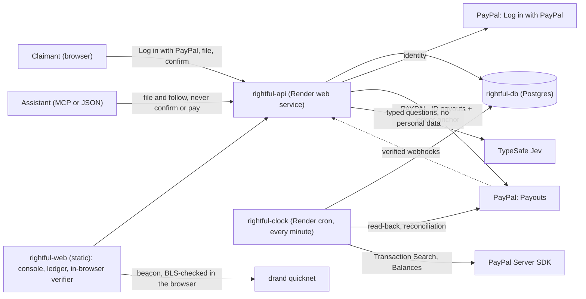

# Rightful

**Settlement payouts claim farms can't drain.** One claim per verified PayPal account, AI-triaged
rings a person decides, and a payout ledger PayPal itself keeps a copy of. PayPal sandbox only.

## For judges

| Try | Where |
| --- | --- |
| Run a whole $2M settlement as its administrator (no sign-in, ~10 s to seed) | https://rightful-web.onrender.com → **Run a $2M program as the administrator** |
| A real sandbox payout, as its claimant sees it | https://rightful-web.onrender.com/claim/clm_n1bJwZ5ALKjI0c_K → **Open my receipt** |
| Check that ledger in your browser (Merkle root, PayPal's records, drand BLS, audit sample) | https://rightful-web.onrender.com/l/prg_7Gj9VD1w1pfaBqZ_?claim=clm_n1bJwZ5ALKjI0c_K → **Verify in my browser** |
| File a claim yourself (US sandbox *personal* account) | https://rightful-api.onrender.com/claim/start?program=prg_rh4Pg_Ch_CzamLn9 (open until Dec 19) |
| Let an assistant file for you (MCP, Streamable HTTP) | `https://rightful-api.onrender.com/mcp` · [docs/agents.md](docs/agents.md) |
| The API contract (OpenAPI 3.1) | https://rightful-api.onrender.com/openapi.json |

Where to look in the code: the money path is [`src/claims/distribute.ts`](src/claims/distribute.ts)
(commit, then pay), [`src/claims/ledger.ts`](src/claims/ledger.ts) (the ledger, shared with the
browser verifier) and [`src/claims/reconcile.ts`](src/claims/reconcile.ts) (PayPal's books); the AI
is [`src/rings/investigate.ts`](src/rings/investigate.ts); the agent channel is
[`src/api/mcp.ts`](src/api/mcp.ts). [AGENTS.md](AGENTS.md) maps every file.

## The problem

A settlement or mass refund splits a fixed pool over every valid claim, so every fake claim is taken
from a real person. Claim fraud has become industrial:

- A payment processor's report counted more than **80 million claims in 2023 with "significant"
  signs of fraud, up over 19,000% since 2021**. A Chicco booster-seat settlement drew more than
  3.3 million claims for about 875,000 seats sold, and was put on hold; a Grande Cosmetics
  settlement drew 6.5 million claims, of which about 110,000 were valid; in the Juul/Altria
  settlement, administrators told the court about 80% of 14 million claims were likely fraudulent.
  Experts say the fraud is moving from bots to groups of people using stolen identities and
  addresses. ([Reuters, May 2024](https://www.insurancejournal.com/news/national/2024/05/03/772747.htm))
- In one case, nearly 5,500 claims came from a single IP address and nearly 1,000 from one
  single-family home. ([Foley & Lardner, July 2024](https://www.foley.com/insights/publications/2024/07/fraud-rising-claims-made-class-action-settlements/),
  citing *Opperman v. Kong Techs.*, N.D. Cal.)
- Claims administrators describe settlement fraud as "industrialized" by bots and AI.
  ([JND Legal Administration, Dec 2025](https://www.jndla.com/blog/administration-at-scale-the-emerging-role-of-ai-in-modern-claims-management))

Administrators are left paying the fraud or freezing everyone while they investigate. Settlements
already pay people through PayPal and Venmo (the $700M Google Play settlement pays most people
automatically that way: [Entrepreneur, Dec 2025](https://www.entrepreneur.com/business-news/heres-how-to-claim-your-part-of-a-700m-google-settlement/500752)),
so PayPal is already where the money goes. Rightful makes it where the identity check and the proof
come from too.

**Who it is for:** claims administrators, and merchants running refund or recall programs. They plug
Rightful in for claim intake, ring triage and payout; claimants file free and get paid to their own
PayPal account. **How it would be sold:** per program, priced per paid claim.

## How it works

- **One claim per verified PayPal account.** Claimants sign in with **Log in with PayPal**. The
  program sees a per-program pseudonym, never the PayPal account ID (kept only encrypted, to pay), and
  a second claim from the same account is refused; signing in again shows the existing claim. The
  email and mailing address are kept for ring detection and shown to the administrator; the public
  ledger has neither.
- **Agents can file; only people get paid.** A person's assistant can file over MCP or plain JSON
  (one path, one rate limit). It has no tool to confirm, decide or pay: the claim waits, unbound,
  until its person signs in with PayPal and confirms it. See [docs/agents.md](docs/agents.md).
- **Rings are held, not paid.** Claims that share devices, inboxes, buildings, networks or a scripted
  story are grouped by a deterministic detector. An investigator (TypeSafe Jev, typed answers only)
  rates each group, the memo's facts are computed in code, a fixed rule recommends deny, review or
  clear, and **a person decides**.
- **Held is not denied.** Every claimant has a status page with no personal data on it. A claimant
  held for review can ask a person to look again, once; the request shows up next to the memo in the
  console and decides nothing by itself.
- **The ledger comes first.** Before any payout is sent, every payout (claim, pseudonym, amount) is
  hashed into a Merkle root that also names a drand round still in the future. Each claimant gets a
  receipt proving their payout is in it. Once anyone has kept the root or a receipt, adding or
  changing a payout breaks the match: the ledger is tamper-evident, not tamper-proof.
- **PayPal keeps a copy.** Every Payouts batch carries the ledger's digest in its message, and every
  payment carries it in its note, so each claimant's own PayPal payment names the ledger it was paid
  from. The verifier checks that PayPal's records, read back from PayPal, all name this ledger.
- **Paid to the account that signed in.** PayPal Payouts sends each share with
  `recipient_type: PAYPAL_ID` to the payer ID captured at sign-in, and nowhere else. A payout PayPal
  cannot deliver is listed in the ledger with PayPal's status; its money returns to the program and is
  never re-sent elsewhere.
- **PayPal's books must agree.** Before a live program pays, a Balances check refuses to start if the
  account cannot fund it. After payouts settle, every paid claim is looked up in PayPal's transaction
  history: a completed debit of exactly the share, under the transaction ID Payouts gave it, with a
  note naming the ledger. Signature-verified Payouts webhooks make the API read a batch back sooner;
  the read-back stays the source of truth.
- **An audit nobody picks.** Once the committed drand round is out, its randomness picks the claims to
  audit. Anyone can recompute the ledger and the sample in their browser.

### PayPal surfaces

| Surface | Role in Rightful | Code |
| --- | --- | --- |
| Log in with PayPal | Verified-account gate; the payer ID behind the one-claim rule and the payout | [`src/paypal/identity.ts`](src/paypal/identity.ts), [`src/api/login.ts`](src/api/login.ts) |
| Payouts (`PAYPAL_ID`) | Pays each approved claim to the account that signed in; the ledger digest rides in the batch message and every item note | [`src/paypal/payouts.ts`](src/paypal/payouts.ts), [`src/claims/payouts-port.ts`](src/claims/payouts-port.ts) |
| Payouts read-back | Source of truth for delivered / not delivered; reads the ledger anchor back from PayPal | [`src/claims/distribute.ts`](src/claims/distribute.ts) |
| Transaction Search (PayPal Server SDK) | Every paid claim found in PayPal's own history, exactly as the ledger says | [`src/paypal/sdk.ts`](src/paypal/sdk.ts), [`src/claims/reconcile.ts`](src/claims/reconcile.ts) |
| Balances (PayPal Server SDK) | A live program refuses to pay if the account cannot fund it | [`src/paypal/sdk.ts`](src/paypal/sdk.ts), [`src/claims/reconcile.ts`](src/claims/reconcile.ts) |
| Webhooks + signature verification | Payouts events, verified with PayPal, recorded once, then a read-back | [`src/claims/webhooks.ts`](src/claims/webhooks.ts) |

Every money call carries a `PayPal-Request-Id` derived from our own IDs, batch IDs come from the
program (a retry returns the original batch), and the client refuses anything but the sandbox
([`src/paypal/client.ts`](src/paypal/client.ts)).

### Architecture



Service by service, and why each is separate: [docs/architecture.md](docs/architecture.md).

## Numbers, and what they measure

On the demo program (a held-out seed the investigator was never tuned on), the investigator
recommends denying 50 groups (1,255 ring claims, no real claimant) and clearing 25 (96 real
claimants, no ring claim), and leaves 30 mixed groups (155 ring claims, 77 real claimants) to a
person:

| How the $2M is paid | Each paid claim | To rings | Real claimants denied |
| --- | --- | --- | --- |
| Pay every claim | $400.00 | $600,000 | 0 |
| Pay every verified PayPal account | $460.08 | $551,176 | 351 (unverified accounts) |
| Rightful, mixed groups all cleared | $588.75 | $136,001 | 0 |
| Rightful, mixed groups all denied | $631.91 | $48,025 | 77 |

A person who opens the mixed groups lands between the last two rows. In every Rightful row, 334 real
claimants with unverified PayPal accounts are held (not denied) until they verify. **So in the
strictest row, 411 of 3,500 real claimants (11.7%) are not paid at distribution: 77 denied and 334
waiting to verify.** Those 77 can ask for a review before anyone decides.

- **Detector, held-out programs** (seeds 101-110, 5,000 claims each, 30% from rings): 99.9%
  precision, 93.5% recall, 0.1% of genuine claimants held. Paying every verified account instead:
  45.9% precision, 20.0% recall, about $552k of a $2M pool to rings. Rings built to evade (distinct
  everything, own words, filed over weeks) are not caught; one claim per PayPal account is the
  backstop.
- **Investigator, held-out** (seeds 101-105, a sensitive detector setting that also flags
  households): its deny recommendations are right 98.7% of the time, it cleared no ring, and it
  cleared 62% of the innocent groups, cutting genuine claimants held from 4.6% to 1.8%.
- CI fails if these held-out numbers slip ([`test/eval-gate.test.ts`](test/eval-gate.test.ts)).

**All of these numbers come from our own synthetic generator** ([`src/rings/synthetic.ts`](src/rings/synthetic.ts)),
with known rings of four kinds and genuine claimants built to look suspicious (households, dorms,
people who paste the sample text). They measure the system against that generator, not against real
fraud.

## What is real and what is simulated

- **Real, in the PayPal sandbox:** Log in with PayPal, Payouts to `PAYPAL_ID` (the live checks pay
  $1.00 per claim), PayPal's read-back of the ledger anchor, Transaction Search, Balances, webhooks.
- **Simulated:** the $2M demo's 5,000 claimants are synthetic, so its Payouts batches are simulated
  (no sandbox account holds $2M, and synthetic people have no PayPal accounts). Its ledger, drand
  round, audit sample and verifier are real; the verifier marks the PayPal check "not applicable".
- **Replayed:** the hosted investigator replays recorded TypeSafe answers
  ([`eval/`](eval/)), so judges and CI need no key; with a key set it asks live for groups it has no
  answer for.
- **Sandbox lag:** PayPal's sandbox transaction history can trail payouts by hours; the ledger page
  shows "waiting for PayPal's history" until it catches up, and only reports a mismatch after that.

## Built with

PayPal (Log in with PayPal, Payouts, Transaction Search, Balances, Webhooks) · PayPal Server SDK,
generated by APIMatic and integrated with APIMatic's Context Plugin (contract sheet:
[paypal-plan.md](paypal-plan.md)) · TypeSafe Jev · MCP TypeScript SDK · TypeScript, Hono, React,
Vite · Postgres (PGlite locally) · drand · Render (Blueprint: web service, static site, cron job,
Postgres, env group: [render.yaml](render.yaml)) · GitHub Actions.

## Run it

```bash
npm install
npm test                    # 70 tests: ledger, claims, payouts, webhooks, contract, detector, investigator
npm run demo                # seed the demo program in-process and print its rings and scoreboard
npm run eval:rings          # detector vs a VERIFIED-only baseline on synthetic programs (offline)
npm run dev:api:fake        # the API with in-memory Payouts (no PayPal app needed) …
npm run dev:web             # … and the web app on http://localhost:5173
```

No database to install: without `DATABASE_URL` the API runs Postgres in-process (PGlite). With a
PayPal sandbox app ([docs/day0-sandbox-setup.md](docs/day0-sandbox-setup.md)) and the API deployed:

```bash
npm run open:program -- --pool 2   # opens a $2 program, files one claim as an agent, prints links
npm run pay:program -- <programId> # review → ledger → payouts → audit, followed to the end
npm run webhook:register           # registers the Payouts webhook for the deployed API
```

## License

[MIT](LICENSE)
